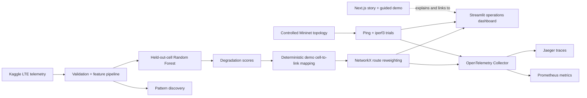

# Predictive Network Degradation & Route Optimizer

[](https://github.com/ParthrChandurkar/predictive-network-route-optimizer/actions/workflows/ci.yml)
[](https://github.com/ParthrChandurkar/predictive-network-route-optimizer/releases)
[](LICENSE)

An evidence-led network simulation platform that learns unusual LTE behavior from real telemetry, converts degradation scores into routing costs, and tests risk-aware paths under controlled network impairment.

[View the landing page](https://predictive-network-route-optimizer.vercel.app) · [Try the browser demo](https://predictive-network-route-optimizer.vercel.app/demo) · [Inspect the final evaluation](reports/phase8_final_evaluation.json)

> The public Next.js site explains the project and includes a guided route-decision demo. The Streamlit application is the complete simulation and network-operations dashboard. Streamlit is currently run locally; the website does not pretend that the full dashboard is hosted.

## Project status

**v1.0 complete.** The data pipeline, held-out evaluation, pattern analysis, routing integration, Mininet experiment, observability stack, Streamlit dashboard, public web experience, automated tests, and release documentation are implemented. Future work is optional extension rather than unfinished core functionality.

## What the project delivers

- A validated adapter for the Kaggle **Anomaly Detection in 4G Cellular Networks** dataset
- Leakage-aware Random Forest evaluation with LTE cells held out between folds
- Failure-pattern analysis with spatial, temporal, KPI-shift, and rule evidence
- Six route variants: conventional and risk-aware Dijkstra, Bellman-Ford, and Floyd-Warshall
- An eight-workflow Streamlit dashboard for topology editing, scoring, routing, failures, benchmarks, and evidence review
- A repeated Mininet experiment that measures real emulated traffic with `ping` and `iperf3`
- OpenTelemetry traces and metrics exported through a Collector to Jaeger and Prometheus
- A responsive Next.js landing page and guided browser demo deployed on Vercel

## Validated results

| Evidence class | Result | Meaning |
|---|---:|---|
| Held-out LTE cells | F1 **0.8323** | Random Forest classification on cell-separated folds |
| Held-out LTE cells | ROC-AUC **0.9536** | Ranking performance on unseen cells |
| Validated pattern | **100% precision**, **40.56% coverage** | A narrow `mean_ue_ul` rule matched 1,231 unusual validation rows; it may reflect quantization or label construction |
| Controlled Mininet | **0.333 → 1.168 Mbps** (**+251.19%**) | Mean TCP throughput across three repetitions per policy |
| Controlled Mininet | **278.154 → 92.977 ms** (**−66.57%**) | Mean RTT across the same experiment |
| Controlled Mininet | **13.33% → 13.33% loss** | Packet loss did not improve |

The model metrics, integration checks, and emulator results are consolidated in [`reports/phase8_final_evaluation.json`](reports/phase8_final_evaluation.json). They are not production-network guarantees.

## System architecture



The LTE dataset contains cellular KPIs, not the physical router graph used by the demo. Cell scores are therefore assigned to graph links with a deterministic demonstration mapping, clearly labeled in both code and UI.

## Streamlit dashboard

The main application is organized around eight operator workflows:

| Tab | What it provides |
|---|---|
| Network Ops | Live topology, fabric health, route overlays, control-plane posture, and Mininet evidence |
| Risk Intelligence | Held-out metrics, Kaggle CSV validation, LTE model scoring, and time-slot risk mapping |
| Pattern Discovery | Cell/hour distributions, KPI shifts, validated rules, and artifact warnings |
| Topology | Add/remove routers and add/remove/update links |
| Route Control | Compare distance-only and risk-aware decisions with route provenance |
| Benchmarks | Compare all six algorithms, final metrics, matrices, and complexity |
| Failure Lab | Apply stress, random or manual link failures, and restore the topology |
| Insights | Review observability endpoints, model evidence, route evidence, and link inventory |

## Run the Streamlit dashboard

Python 3.11 is the tested development version.

```powershell
python -m venv .venv
.\.venv\Scripts\Activate.ps1
python -m pip install --upgrade pip
python -m pip install -r requirements.txt
python -m streamlit run app.py
```

On Linux or macOS, activate with `source .venv/bin/activate`. The dashboard opens at `http://localhost:8501` and works with the bundled synthetic baseline. LTE upload/scoring panels require the prepared data and model artifacts described below.

To publish the dashboard, follow [`docs/streamlit-deployment.md`](docs/streamlit-deployment.md). Streamlit Community Cloud requires the repository owner to connect GitHub, so that final account-level step is intentionally manual.

## Prepare the LTE dataset

Dataset: [Anomaly Detection in 4G Cellular Networks on Kaggle](https://www.kaggle.com/competitions/anomaly-detection-in-4g-cellular-networks)

Accept the competition rules and authenticate the Kaggle CLI, then run from PowerShell:

```powershell
New-Item -ItemType Directory -Path "data/raw/lte" -Force | Out-Null

kaggle competitions download -c anomaly-detection-in-4g-cellular-networks `
  -f ML-MATT-CompetitionQT2021_train.csv -p data/raw/lte
kaggle competitions download -c anomaly-detection-in-4g-cellular-networks `
  -f ML-MATT-CompetitionQT2021_test.csv -p data/raw/lte

Expand-Archive -LiteralPath "data/raw/lte/ML-MATT-CompetitionQT2021_train.csv.zip" `
  -DestinationPath "data/raw/lte" -Force
Expand-Archive -LiteralPath "data/raw/lte/ML-MATT-CompetitionQT2021_test.csv.zip" `
  -DestinationPath "data/raw/lte" -Force
```

Build every derived artifact and refresh the final evaluation:

```powershell
python -m telemetry.prepare_lte
python -m modeling.lte_evaluation
python -m modeling.lte_model
python -m analysis.lte_patterns
python -m evaluation.phase8
```

Raw/processed competition data and the trained LTE model are intentionally ignored by Git. Source hashes, validation counts, model provenance, and evaluation outputs are committed under `reports/`.

## Run the controlled Mininet experiment

Mininet requires Linux network namespaces and root privileges. On Windows, install Ubuntu under WSL2, then use the included installer and experiment plan:

```powershell
$repoPath = (Get-Location).Path
wsl -d Ubuntu --cd "$repoPath" -- sudo bash scripts/install_mininet_ubuntu.sh

python -m experiments.mininet_plan
python -m experiments.mininet_runner reports/phase4_mininet_plan.json --dry-run

wsl -d Ubuntu --cd "$repoPath" -- sudo python3 experiments/mininet_runner.py `
  reports/phase4_mininet_plan.json --output reports/phase4_mininet_results.json
```

If a run is interrupted, clean stale interfaces with `wsl -d Ubuntu -- sudo mn -c`. The committed report records the WSL2 kernel, Mininet and `iperf3` versions, raw trials, route ordering, and aggregate results.

## Run observability locally

With Docker Desktop running:

```powershell
docker compose -f compose.observability.yaml up -d
$env:OBSERVABILITY_ENABLED = "true"
$env:OTEL_EXPORTER_OTLP_ENDPOINT = "http://localhost:4318"
python -m streamlit run app.py
```

- Jaeger: `http://localhost:16686`
- Prometheus: `http://localhost:9090`
- OpenTelemetry Collector health: `http://localhost:13133`

Routing decisions, LTE inference, and Mininet trial measurements are instrumented. Stop the stack with `docker compose -f compose.observability.yaml down`; Prometheus data stays in its named volume unless you explicitly add `--volumes`.

## Run the landing page

The Next.js application includes the project story and a deliberately bounded `/demo` route. The browser demo uses fixed scenarios to explain route reweighting; it does not run the LTE model, Mininet, observability stack, or the full Streamlit workflow.

```powershell
Set-Location web
npm ci
npm run dev
```

Open `http://localhost:3000`. If Streamlit is later hosted separately, set `NEXT_PUBLIC_STREAMLIT_URL` before building; otherwise dashboard buttons lead to these local setup instructions.

## Verification

```powershell
python -m unittest discover -s tests

Set-Location web
npm run typecheck
npm test
npm run build
```

The same checks run automatically on every push and pull request through [GitHub Actions](.github/workflows/ci.yml). The v1.0 release evidence is recorded in [`reports/phase10_release.json`](reports/phase10_release.json).

## Repository map

| Path | Responsibility |
|---|---|
| `app.py`, `ui/` | Streamlit simulation and operations UI |
| `telemetry/` | Kaggle schema validation and ingestion |
| `modeling/` | Leakage-aware evaluation and LTE model artifact |
| `analysis/` | Failure-pattern discovery |
| `integration/` | LTE-score to graph-risk demonstration mapping |
| `routing.py`, `network_builder.py`, `simulation.py` | Graph algorithms, topology state, and failures |
| `experiments/` | Mininet plan and measurement runner |
| `observability/`, `compose.observability.yaml` | OTel Collector, Jaeger, and Prometheus stack |
| `evaluation/`, `reports/` | Cross-phase validation and committed evidence |
| `web/` | Vercel-hosted Next.js landing page |
| `.github/workflows/ci.yml` | Python and Next.js continuous integration |
| `tests/` | Unit and dashboard regression tests |

## Claim boundaries

- LTE labels represent **unusual cellular behavior**, not confirmed physical-link failures.
- The dataset exposes time of day but no calendar date, so full chronological ordering cannot be reconstructed.
- The LTE cell-to-link relationship is a deterministic integration demo, not a discovered physical topology.
- Mininet results come from three controlled repetitions per policy and should not be generalized to production networks.
- The validated KPI signature is predictive in the held-out sample, but its sharp boundary may be a dataset artifact rather than a causal failure mechanism.
- This system recommends and compares routes; it does not configure physical routers.

## License

Released under the [MIT License](LICENSE).
